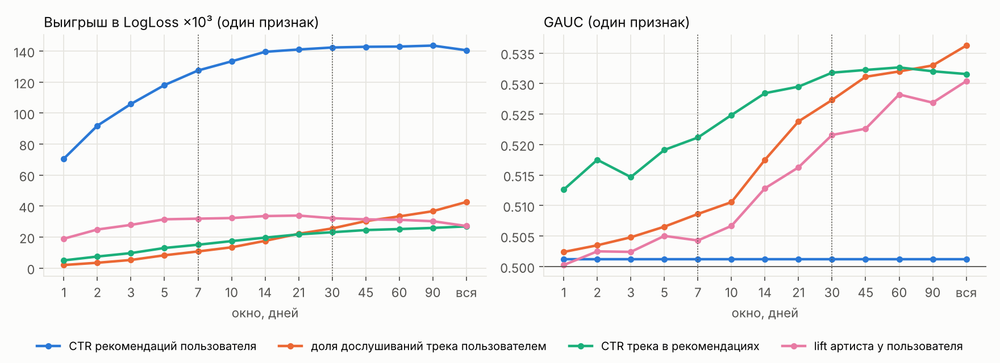
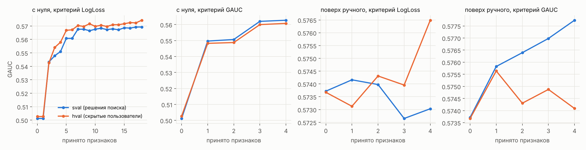
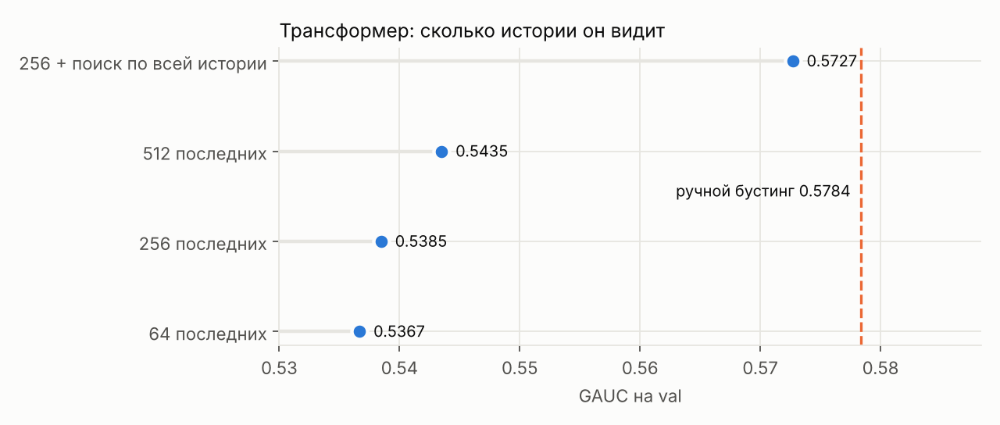
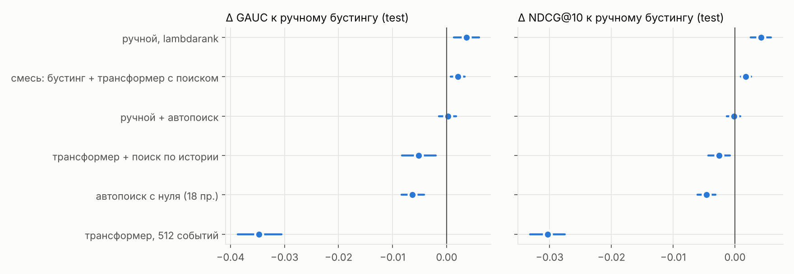
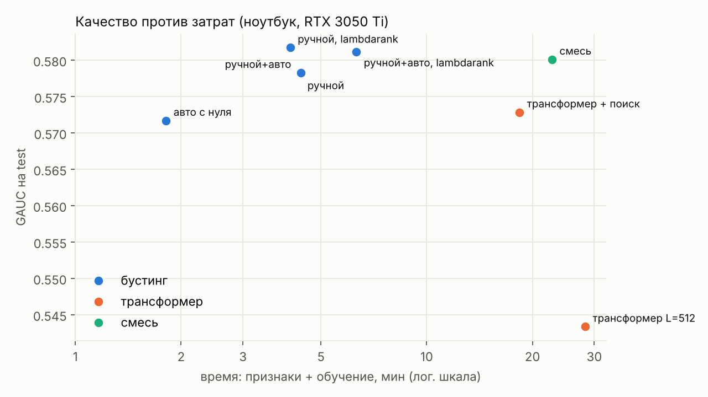

# Можно ли заменить ручные признаки? Бустинг, автопоиск признаков и трансформер над историей (Yambda-50M)

Отчёт к заданию отбора на стажировку (Т-Банк, AI Research). Задача: построить сильный градиентный бустинг на ручных признаках, а затем проверить, можно ли автоматизировать построение признаков или заменить их обучаемым представлением без потери качества.

- **Репозиторий:** `https://github.com/AlexDm207/yambda-features`
- **Автор:** Дмитрович Александра Дмитриевна
- **Данные:** Yambda-50M (Яндекс Музыка): `flat/50m/multi_event.parquet` и справочники «трек → артист», «трек → альбом»
- **Железо:** один ноутбук, 16 ГБ RAM, RTX 3050 Ti (4 ГБ). Все запуски локальные, в щадящем режиме (2 потока, пониженный приоритет)

---

## 1. Резюме

**Постановка.** Показ — трек, который запустила рекомендательная система (`is_organic = 0`). Клик — пользователь дослушал трек до 50% и дальше. Модель должна ранжировать показы пользователя внутри дня. Признаки для показа в день *d* строятся только по событиям дней раньше *d*. Разбиение по времени: train — дни 226–285, val — 286–292, test — 294–300. Кандидаты (реальные показы) и информация одинаковы для всех подходов.

**Главные результаты на test** (Δ к ручному бустингу, 95% интервал по бутстрепу пользователей):

| Подход | GAUC | NDCG@10 | Δ GAUC | Время |
|---|---|---|---|---|
| Лучшая эвристика («слышал ли трек раньше») | 0,5410 | 0,7468 | — | — |
| **Бустинг, 65 ручных признаков** | **0,5781** | **0,7717** | — | 4 мин |
| то же, цель lambdarank | 0,5817 | 0,7760 | **+0,0037** [+0,0013; +0,0060] | 4 мин |
| Автопоиск с нуля (18 признаков из 1906 кандидатов) | 0,5717 | 0,7671 | −0,0063 [−0,0084; −0,0042] | 2 мин + 28 мин поиска |
| Ручной набор + автопоиск | 0,5783 | 0,7716 | +0,0002 [−0,0014; +0,0018] | 4 мин + поиск |
| Трансформер, последние 512 событий | 0,5434 | 0,7414 | −0,0347 [−0,0387; −0,0305] | 28 мин |
| **Трансформер + поиск по всей истории** | **0,5729** | 0,7692 | −0,0052 [−0,0083; −0,0020] | 18 мин |
| **Смесь: бустинг + трансформер с поиском** | **0,5801** | 0,7735 | **+0,0021** [+0,0008; +0,0033] | 4 + 18 мин |

**Выводы.**

1. **Сильный бустинг на ручных признаках трудно превзойти.** Автопоиск по грамматике из 1906 признаков почти догоняет его с вчетверо меньшим набором (18 признаков). Однако ни один найденный набор не превзошёл ручной значимо, ни с нуля, ни в дополнение к нему. Дневные агрегаты истории, судя по всему, исчерпаны.
2. **Автопоиск легко переобучается на валидации.** Это видно только благодаря скрытой от поиска половине пользователей. С критерием GAUC поиск «выиграл» +0,004 на своей выборке и только +0,0004 на скрытой. Жадный критерий GAUC к тому же не видит взаимодействий признаков и застревает на 4 признаках.
3. **Трансформеру мешает не мощность, а то, сколько истории он видит.** 512 последних событий — это около месяца, ~10% истории. Лучшие же ручные признаки считаются по всей истории. Поиск событий с тем же треком и артистом по всем 300 дням (идея SIM) сокращает отставание от бустинга в 6–7 раз: с −0,035 до −0,005 GAUC.
4. **Трансформер с поиском извлекает информацию, которой нет в ручных агрегатах.** Его смесь с бустингом — значимое улучшение и на val, и на test. Смесь с трансформером без поиска ничего не даёт.
5. **Поточечная цель и ранжирование расходятся.** 74% важности поточечной модели — «CTR пользователя», а он вообще не различает треки внутри дня. Цель lambdarank переносит важность на признаки пары «пользователь–трек» и даёт значимый прирост порядка (+0,0037 GAUC на test).

---

## 2. Данные и постановка

### 2.1. Почему «дослушивание рекомендованного трека»

В Yambda есть флаг `is_organic`. Прослушивание с `is_organic = 0` запущено рекомендательной системой, это естественный аналог показа, а дослушивание (`played_ratio_pct ≥ 50`) — аналог клика. Так получается ровно схема «показ → клик» из условия. Набор кандидатов задан логами и одинаков для всех подходов, поэтому не нужен отдельный генератор кандидатов, который сам по себе влиял бы на сравнение.

| | Показов | Пользователей | Треков | Доля дослушиваний | Групп «пользователь–день» |
|---|---|---|---|---|---|
| train (дни 226–285) | 5 523 724 | 8 051 | 293 951 | 0,678 | 166 059 |
| val (286–292) | 734 470 | 6 257 | 126 232 | 0,692 | 21 487 |
| test (294–300) | 725 905 | 6 163 | 127 368 | 0,707 | 21 007 |

История для признаков — все 47,8 млн событий всех типов (прослушивания, лайки, дизлайки, отмены) за дни 0–300 у 10 000 пользователей. Сэмплирования пользователей нет.

### 2.2. Что показал EDA и как это повлияло на решения

| Наблюдение | Решение |
|---|---|
| Разброс доли дослушиваний между пользователями (std 0,27) больше, чем между треками (0,16) | Общий ROC-AUC во многом меряет «угадала ли модель пользователя-скипера». Главные метрики — **GAUC** (AUC внутри группы «пользователь–день», среднее по группам) и **NDCG@10** внутри группы |
| В группе в среднем 20 показов, 72% групп смешанные | Метрики ранжирования считаются по смешанным группам (~15 тыс. на val и на test) |
| Знакомый трек дослушивают на 6,5 п. п. чаще, знакомого артиста — на 8,7 п. п.; 59% показов — повторы | Нужны и прямые связи (пользователь–трек), и косвенные (пользователь–артист/альбом) |
| Лишь 1% показов — треки, которых до этого дня не слушал никто | Холодный старт треков почти не мешает |
| Первый показ дня дослушивают в 57% случаев, остальные — в ~69% | Внутридневной контекст важен, но **мы его сознательно не используем**: история только до вчерашнего дня. Это ограничение постановки (раздел 8) |
| Доля дослушиваний растёт по времени: 0,68 → 0,71 | LogLoss на test слегка страдает от сдвига, метрики внутри группы к нему устойчивы |

---

## 3. Протокол и защита от утечек

- **Временное разбиение** с буферным днём 293 между val и test.
- **Правило признаков:** для показа в день *d* используются только события дней `< d`. Сам показ и всё, что было позже в тот же день, недоступны. Трансформер видит ровно ту же историю.
- **Решения только по val.** Ранняя остановка, выбор признаков, гиперпараметры, веса смеси и выбор эпохи — всё по val. Список финальных моделей зафиксирован до первого обращения к test, test считался **один раз** (`scripts/run_final.ps1`), без переобучения моделей.
- **Интервалы:** парный бутстреп по **пользователям** (1000 повторов, пуассоновские веса), `scripts/compare.py`. Бутстреп по группам занизил бы интервал: дни одного пользователя зависимы. Шум обучения бустинга (другой seed) — ±0,0007 GAUC, интервалы содержат ноль.

**Три независимые проверки на утечки:**

1. **Движок признаков против расчёта «в лоб»** (`scripts/check_leaks.py`). Для случайных показов каждый признак пересчитан прямой фильтрацией сырых событий `day < d`. Результат: 300 показов × 65 ручных признаков и 100 показов × 300 случайных кандидатов автопоиска всех видов — **0 расхождений**.
2. **Перемешанные метки train** для нейросетей (`--shuffle_train_labels`). Честная модель обязана дать GAUC ≈ 0,5. Получилось 0,494 и для трансформера, и для трансформера с поиском.
3. **Синтетика со случайными метками** перед каждым запуском на реальных данных. Эта проверка **поймала реальную утечку** в первой версии трансформера: GAUC 0,66 на случайных метках. Причина — граница группы при нарезке примеров считалась по соседней строке того же сплита, и в обучающий пример попадали кандидаты val/test вместе с метками. Ошибка исправлена, добавлена проверка-assert.

---

## 4. Базовый подход: бустинг на ручных признаках

### 4.1. Движок признаков

Любой признак описывается строкой `вид:сущность:статистика:окно`. Примеры:

- `rate:ua:full/n:30` — доля дослушанных треков этого артиста у пользователя за 30 дней;
- `sum:ui:full:inf` — сколько раз пользователь дослушал этот трек за всю историю;
- `recency:ui` — сколько дней прошло с последнего прослушивания этого трека.

| Элемент | Значения |
|---|---|
| Сущности | пользователь, трек, артист, альбом; пары пользователь–трек, пользователь–артист, пользователь–альбом |
| Статистики | прослушивания, дослушанные, показы рекомендаций, дослушанные рекомендации, органические, сумма долей, секунды, лайки, дизлайки, снятия лайка |
| Виды | сумма, доля, share (доля в истории пользователя), recency, age, drift, lift |

**Устройство (`features/engine.py`).** Для каждой сущности один раз строится таблица накопительных сумм по дням. Сумма за окно из *w* дней до дня *d* равна S(d−1) − S(d−1−*w*), а каждое S — одно asof-соединение. Поэтому признак с любым окном стоит одинаково, и перебор окон в автопоиске дешёвый. Таблицы пар считаются порциями по 16 корзинам пользователей, так что пиковая память не превышает нескольких ГБ. Время расчёта 65 признаков для 7 млн показов — 61 с.

### 4.2. Ручной набор (65 признаков, `features/handcrafted.py`)

Пять групп с «круглыми» окнами 1/7/30 дней и вся история:

| Группа | Признаков | Примеры |
|---|---|---|
| пользователь | 15 | CTR рекомендаций, доля органики, средняя доля прослушивания |
| трек | 16 | популярность, CTR трека, длина, возраст |
| артист и альбом | 7 | популярность, доля дослушиваний |
| прямые связи | 13 | сколько раз слушал и дослушал этот трек, лайки и дизлайки, recency |
| косвенные связи | 14 | то же для артиста и альбома, доля артиста в истории |

Модель — LightGBM (127 листьев, lr 0,05, ранняя остановка по val).

### 4.3. Результаты и абляции (val)

| Модель | LogLoss | AUC | GAUC | NDCG@10 |
|---|---|---|---|---|
| случайный порядок | — | 0,500 | 0,502 | 0,713 |
| «CTR пользователя» (одна эвристика) | — | **0,814** | 0,502 | 0,713 |
| «слышал ли трек раньше» | — | 0,540 | 0,544 | 0,743 |
| **бустинг, binary** | 0,4468 | 0,837 | 0,5784 | 0,7672 |
| бустинг, lambdarank | — | 0,663 | **0,5830** | **0,7728** |

Один признак «CTR пользователя» даёт AUC 0,81 и при этом нулевую пользу для порядка треков внутри дня. Это главная причина смотреть на GAUC и NDCG, а не на AUC.

**Абляции** (убрали группу и переобучили; Δ к полному набору, 95% интервал):

| Без группы | Δ GAUC | Δ NDCG@10 |
|---|---|---|
| пользователь | **−0,0205** [−0,0235; −0,0176] | −0,0206 |
| трек | −0,0064 [−0,0085; −0,0043] | −0,0028 |
| прямые связи | −0,0041 [−0,0058; −0,0025] | **−0,0063** |
| косвенные связи | −0,0044 [−0,0065; −0,0021] | −0,0029 |
| артист и альбом | +0,0001 [−0,0014; +0,0016] | −0,0006 |

- **Признаки пользователя нужны и для порядка внутри дня**, хотя для одного пользователя они одинаковые. Они служат контекстом для взаимодействий: для «скипера» знакомость трека значит больше. Деревья ловят такие взаимодействия.
- **Статистики артиста и альбома не нужны**: 7 признаков, добавленных «по здравому смыслу», не дают ничего. Пример того, почему ручной отбор неоптимален.
- **Цель обучения определяет, что модель считает важным.** У поточечной модели 74% важности — CTR пользователя. У lambdarank на первом месте прямые связи (15% и 9%) и длина трека (6%).

---

## 5. Исследовательская идея 1: автоматический поиск признаков

### 5.1. Грамматика и поиск (`features/grammar.py`, `search/autofe.py`)

**Пространство: 1906 кандидатов.** 7 сущностей × 10 статистик × 13 окон (1, 2, 3, 5, 7, 10, 14, 21, 30, 45, 60, 90 дней и вся история) × виды признаков. Среди видов два — комбинации:

- **drift** — доля за короткое окно минус доля за длинное;
- **lift** — доля дослушиваний артиста у пользователя минус его средняя.

Ручной набор — 65 точек этого пространства.

**Выборки.** Пользователи делятся на две половины:

- `train` — последние 14 дней train у первой половины (0,7 млн показов);
- `sval` — val **той же** половины. По нему поиск принимает решения;
- `hval` — val **другой** половины. Поиск его не видит, он нужен только для контроля переобучения.

**Этапы:**

1. Расчёт всех кандидатов.
2. Одномерный отсев: бустинг на одном признаке, выигрыш в LogLoss и GAUC.
3. Пул лучших кандидатов с удалением почти-дубликатов (ранговая корреляция |ρ| > 0,97).
4. Жадный прямой отбор: добавляем кандидата, если улучшение на `sval` больше порога. Порог задан по шуму, обучение внутри поиска детерминированное.

Два старта: **с пустого набора** (может ли поиск заменить человека) и **поверх ручного** (может ли поиск ему помочь). Два раунда:

- раунд 1: пул по сущностям, критерий LogLoss;
- раунд 2: пул по «семействам» признаков (407 кандидатов, разнообразнее), критерий GAUC.

### 5.2. Какое окно лучше: «почему 7 дней, а не 10»



Почти для всех семейств качество растёт с длиной окна:

- CTR пользователя выходит на плато к 30–90 дням;
- доля дослушиваний трека пользователем и CTR трека лучше всего на всей истории. У доли дослушиваний трека выигрыш в LogLoss в 4 раза выше, чем при окне 7 дней;
- единственное семейство с внутренним оптимумом — lift артиста: 14–30 дней по LogLoss.

Память в этих данных длинная, и окна по 7 дней в ручном наборе (пунктир) почти везде хуже. Короткие окна полезны только **в дополнение** к длинным: поиск сам собрал CTR пользователя за 14, 30 и 90 дней сразу.

### 5.3. Результаты поиска



| Запуск | Принято | GAUC sval | GAUC hval | Итог (полное обучение, val) |
|---|---|---|---|---|
| с нуля, LogLoss | 18 | 0,501 → 0,569 | 0,503 → 0,574 | 0,5740 (−0,0044 к ручному) |
| с нуля, GAUC | 4 | 0,501 → 0,563 | 0,503 → 0,561 | 0,5642 (−0,0142) |
| поверх ручного, LogLoss | +4 | −0,0007 | **+0,0028** | 0,5795 (+0,0012, н. з.) |
| поверх ручного, GAUC | +4 | **+0,0040** | +0,0004 | 0,5790 (+0,0006, н. з.) |

Н. з. — незначимо: интервал содержит ноль.

- **С нуля поиск почти догоняет человека** набором вчетверо меньше: 18 признаков против 65, обучение 2 мин против 4. Состав набора осмысленный: CTR пользователя за 14/30/90 дней, доли дослушиваний пары с артистом, альбомом и треком за всю историю, CTR трека, длина, lift трека.
- **Критерий GAUC с нуля застревает.** Признаки пользователя сами по себе GAUC не поднимают, поэтому жадный поиск их отвергает, хотя в сочетании с другими они важнее всего (абляция: −0,02). Жадный одношаговый критерий не видит взаимодействий. LogLoss их учитывает и потому лучше подходит даже для ранжирующей метрики.
- **Переобучение поиска на валидации.** Отбирая по GAUC из 366 кандидатов, поиск набрал тех, кому на `sval` случайно повезло, и на скрытых пользователях выигрыш исчез. LogLoss — более гладкий критерий: отобранное по нему переносится. Без отложенной выборки внутри поиска такой «выигрыш» легко принять за реальный.
- **Затраты.** Расчёт 1906 кандидатов — 2 мин, отсев — 10 мин, жадный отбор — 6–75 мин. На test итог тот же: ручной + авто = +0,0002, авто с нуля = −0,0063.

---

## 6. Исследовательская идея 2: трансформер над историей событий

### 6.1. Модель (`models/seq_ranker.py`, `train/seq.py`)

- **История:** последние *L* событий пользователя до дня показа. Каждое событие — сумма эмбеддингов трека, артиста, типа события (прослушивание с корзиной доли прослушивания, лайк, дизлайк, снятие), органичности и давности. Над ней Transformer encoder, 2 слоя, d = 128.
- **Кандидат:** эмбеддинг трека, артиста и длины. Target attention: кандидат «смотрит» на историю. Эмбеддинги треков общие у истории и кандидатов, поэтому «этот трек уже слушали» модель видит сама.
- **Стоимость:** история кодируется один раз на пользователя-день и используется для всех его кандидатов, так что стоимость не растёт с числом кандидатов. Словари треков (200 тыс.) и артистов (50 тыс.) строятся только по train.
- **Обучение:** BCE, AdamW, OneCycle, выбор эпохи по LogLoss на val.

### 6.2. Длина истории и поиск по истории



Первая версия сильно уступила бустингу: −0,035 GAUC при L = 512. Причина — **доступ к истории**. В среднем у пользователя ~4 800 событий (~16 в день), и 512 событий — это последний месяц, около 10% истории. Лучшие ручные признаки (раздел 5.2) считаются по всей истории. Длина истории монотонно помогает (64 → 256 → 512: 0,537 → 0,539 → 0,544), но её прямое удлинение дорого. Регуляризация (dropout 0,2, weight decay 0,05) качества не добавила, только вдвое сократила время.

**Поиск по истории (ответ на вопрос «как отбирать и сжимать историю»).** Идея из SIM (Pi et al., 2020). Для каждого кандидата из **всей** истории пользователя до дня показа достаются последние 32 события с **этим же треком** и 32 события с **этим же артистом**, а также число совпадений.

- Модель получает сами события, а не их статистики, и сворачивает их вниманием с запросом-кандидатом.
- Индекс — события, отсортированные по ключу «пользователь, объект, день». Поиск двоичный, стоимость не зависит от длины истории, так что подход масштабируется на миллиарды событий.
- Корректность проверена: на 300 случайных кандидатах результат совпадает с полным перебором, 0 расхождений.

| (val) | LogLoss | GAUC | NDCG@10 | Время |
|---|---|---|---|---|
| L = 512 | 0,4598 | 0,5435 | 0,7361 | 28 мин |
| **L = 256 + поиск** | **0,4561** | **0,5727** | **0,7643** | 18 мин |
| бустинг | 0,4468 | 0,5784 | 0,7672 | 4 мин |
| **смесь: бустинг + поиск (w = 0,25 по val)** | **0,4457** | **0,5807** | **0,7689** | |
| смесь: бустинг + L = 512 | 0,4460 | 0,5779 | 0,7662 | |

Поиск сократил разрыв с бустингом с −0,035 до −0,006 на val и до −0,005 на test. Главное, что знают ручные агрегаты «за всю историю», — это личная история пользователя с конкретным треком, и модель может извлечь то же самое из сырых событий, если их ей показать. Смесь с бустингом значимо лучше бустинга (+0,0023 val, +0,0021 test). Значит, трансформер с поиском несёт информацию, которой нет в агрегатах. Предположительно это порядок и типы событий с треком: агрегаты их теряют. Смесь с трансформером без поиска ничего не даёт.

---

## 7. Итоговое сравнение на test





| Модель | LogLoss | AUC | GAUC | NDCG@10 | skip@10 |
|---|---|---|---|---|---|
| случайный порядок | — | 0,500 | 0,5021 | 0,7176 | 0,340 |
| «слышал ли трек раньше» | — | 0,532 | 0,5410 | 0,7468 | 0,320 |
| бустинг (ручной) | 0,4476 | 0,831 | 0,5781 | 0,7717 | 0,297 |
| бустинг (ручной), lambdarank | — | 0,664 | **0,5817** | **0,7760** | 0,296 |
| автопоиск с нуля | 0,4486 | 0,829 | 0,5717 | 0,7671 | 0,300 |
| ручной + автопоиск | 0,4486 | 0,832 | 0,5783 | 0,7716 | 0,297 |
| ручной + автопоиск, lambdarank | — | 0,664 | 0,5812 | 0,7759 | **0,296** |
| трансформер, L = 512 | 0,4630 | 0,822 | 0,5434 | 0,7414 | 0,319 |
| трансформер + поиск | 0,4555 | 0,825 | 0,5729 | 0,7692 | 0,299 |
| **смесь: бустинг + трансформер с поиском** | **0,4461** | **0,833** | 0,5801 | 0,7735 | **0,296** |

skip@10 — доля пропущенных треков среди первых 10 по ранжированию.

Числа на test совпадают с val с точностью до 0,001–0,003, так что выбор моделей по val не переобучен. Лучшие по ранжированию — бустинг с lambdarank и смесь с трансформером, лучшая по LogLoss — смесь. Разница между лучшими моделями мала по абсолюту (~0,4% GAUC). Отсюда тот же вывод: ручные агрегаты почти исчерпывают сигнал, доступный при истории до вчерашнего дня.

---

## 8. Что сработало, что нет, ограничения

**Сработало:**

- движок признаков на накопительных суммах: любое окно за одно соединение, проверка «в лоб»;
- цель lambdarank для ранжирования;
- поиск по всей истории для трансформера;
- смесь бустинга с трансформером;
- отложенная половина пользователей внутри автопоиска: без неё мы бы приняли переобучение за выигрыш.

**Не сработало:**

- автопоиск поверх ручного набора: прирост в пределах шума;
- критерий GAUC в жадном отборе;
- регуляризация трансформера;
- простое удлинение истории (дорого и мало даёт).

**Ограничения:**

- **Нет внутридневной информации.** Первый трек дня дослушивают на 12 п. п. реже, и такой контекст (позиция в сессии, недавние скипы) был бы очень сильным признаком и для бустинга, и для трансформера. Мы его сознательно исключили ради простого и строгого правила «история до вчерашнего дня».
- **Показы ≠ все показы.** В логах есть только запущенные рекомендации; треки, которые система показала, но которые не начали играть, недоступны.
- **10 000 пользователей.** Все пользователи Yambda-50M, но выводы о масштабируемости проверены лишь на этом объёме. Затраты поиска и трансформера измерены на одном ноутбуке.
- **Жадный отбор** — простая стратегия; поиск с учётом взаимодействий (beam search, отбор блоками) не пробовался.
- **Один seed трансформера.** Его разброс между запусками не измерен, в отличие от бустинга.

**Дальнейшая работа:**

- внутридневные признаки и признаки реального времени для обоих подходов;
- поиск по истории с другими ключами (альбом, похожие треки по эмбеддингам) и обучаемым отбором событий;
- ИИ-агент, предлагающий признаки вне фиксированной грамматики (например, условные агрегаты «только по вечерам»);
- стекинг: трансформер с поиском как признак бустинга, с прогнозами вне выборки;
- проверка на большей версии Yambda.

---

## 9. Воспроизведение

```powershell
# окружение: python -m venv .venv; pip install torch --index-url https://download.pytorch.org/whl/cu124; pip install -r requirements.txt
python data/download.py                 # события Yambda-50M (и поправить raw_path в configs/base.yaml)
python data/download_meta.py            # справочники трек→артист/альбом
python data/prepare.py                  # события, показы, метки, разбиение, проверки
python data/eda.py
python scripts/build_cache.py           # накопительные таблицы движка признаков
python train/gbdt.py --name hand        # ручной бустинг (val)
python scripts/check_leaks.py           # движок против расчёта «в лоб»
python scripts/baselines.py
.\scripts\run_day2.ps1                   # lambdarank, абляции групп
.\scripts\run_day2b.ps1                  # шум от seed, интервалы
.\scripts\run_day3.ps1                   # автопоиск, раунд 1
.\scripts\run_day3b.ps1                  # автопоиск, раунд 2
.\scripts\run_day4.ps1                   # трансформер, длина истории (data/prepare_seq.py)
.\scripts\run_day5.ps1                   # поиск по истории (data/prepare_retrieval.py), смеси (val)
.\scripts\run_final.ps1                  # однократная оценка на test
python scripts/make_figures.py
```

Путь к `multi_event.parquet` задаётся в `configs/base.yaml`. Все скрипты идут в щадящем режиме и продолжают с места остановки.

## 10. Структура репозитория

| Путь | Что там |
|---|---|
| `data/` | подготовка данных, EDA, данные для трансформера и индекс поиска |
| `features/engine.py` | движок признаков (накопительные суммы + asof-соединения) |
| `features/handcrafted.py` | ручной набор |
| `features/grammar.py` | грамматика автопоиска |
| `search/autofe.py` | автопоиск: отсев, пул, жадный отбор, контроль на скрытых пользователях |
| `models/seq_ranker.py`, `train/seq.py` | трансформер над историей, поиск по истории |
| `train/gbdt.py` | LightGBM (binary / lambdarank, абляции) |
| `eval/metrics.py` | LogLoss, AUC, GAUC, NDCG@K, skip@K, метрики по группам |
| `scripts/compare.py` | интервалы: бутстреп по пользователям |
| `scripts/check_leaks.py` | проверка признаков «в лоб» |
| `scripts/blend.py` | смесь моделей |
| `scripts/final_test.py` | финальная оценка на test |
| `reports/` | результаты (`results/*.json`), журналы автопоиска (`auto/`), графики (`figures/`), сводные таблицы |
